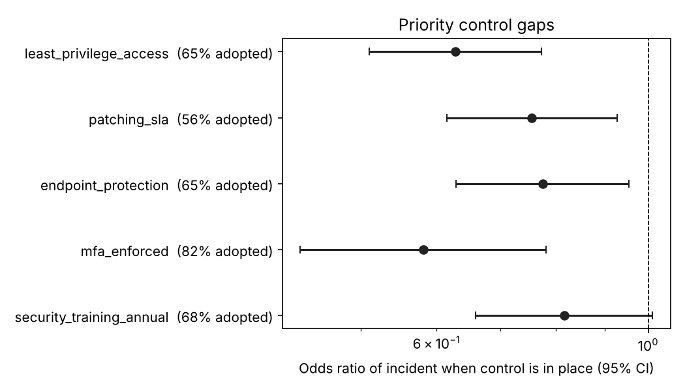
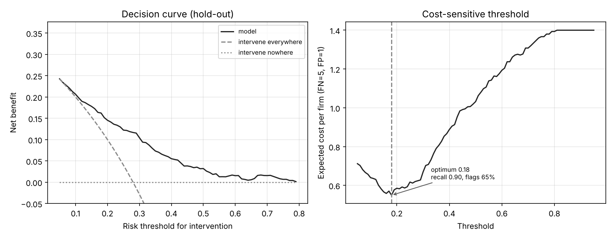
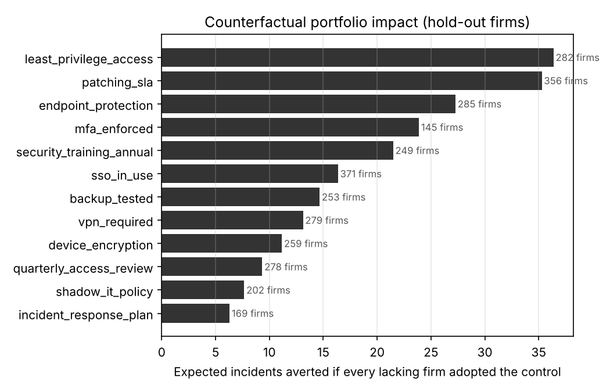
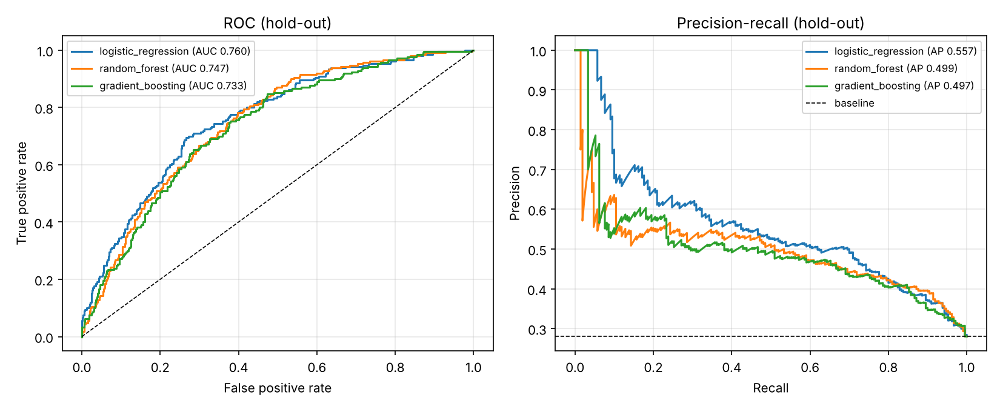
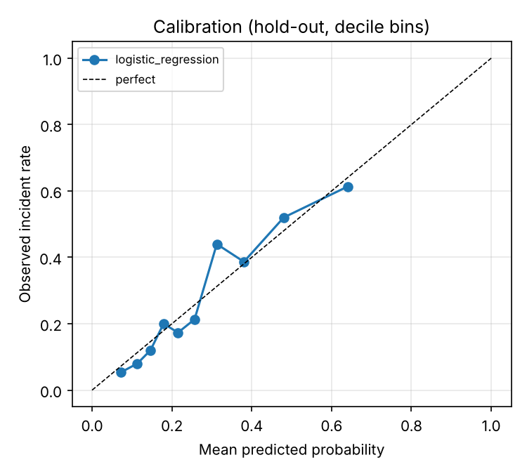
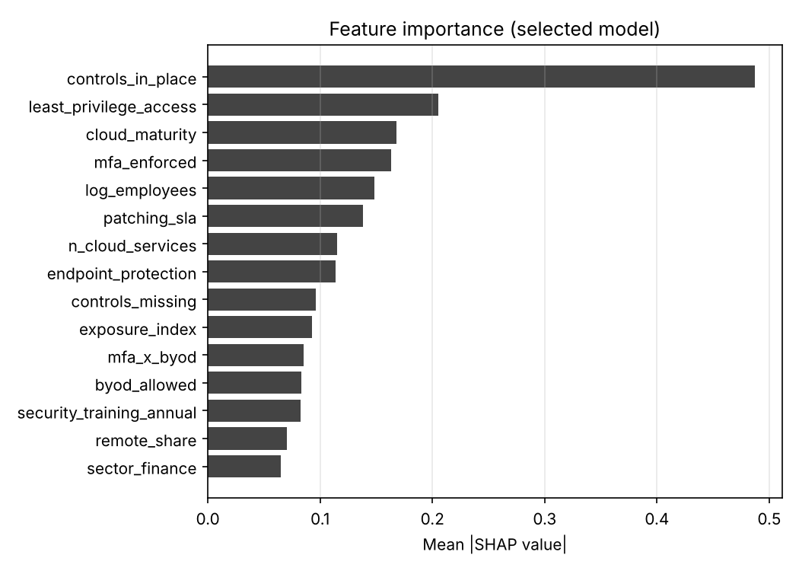

# Predicting Cloud Security Risk for SMEs with Remote Workforces

[](https://github.com/lukmanwahab/sme-cloud-risk/actions/workflows/ci.yml)


An interpretable machine-learning pipeline that estimates each small or medium-sized enterprise's probability of a cloud security incident, quantifies its own uncertainty, picks an operating threshold from explicit costs, audits itself across subgroups, and tells every firm which missing security control to fix first.

The project reproduces, on synthetic data, the modelling workflow I built during a cloud security research programme at Cardiff Metropolitan University (CISST, 2023 to 2025). The original survey is confidential, so the repository ships a documented simulator with a known causal structure. That has a useful side effect: the pipeline's control-gap ranking can be checked against the ground truth that generated the data, and the test suite does exactly that.

<p align="center"></p>

## What the pipeline does

| Stage | Module | Method |
|---|---|---|
| 1. Data | `simulate.py`, `validate.py` | Synthetic survey with documented causal structure and 4% item non-response. Real data passed with `--data` is schema-validated before anything runs. |
| 2. Features | `features.py` | Leakage-safe `ColumnTransformer`: imputation and scaling fitted per fold; engineered exposure index, control counts, an MFA x BYOD interaction, and non-response count as a feature. |
| 3. Models | `train.py` | Logistic regression, random forest and histogram gradient boosting, each tuned by randomised search on inner folds inside stratified 5-fold outer CV (nested CV). Selection on training folds only. |
| 4. Explanation | `explain.py` | SHAP values from the selected model plus odds ratios with Wald 95% CIs from the logistic baseline; controls ranked by impact weighted by the gap rate. |
| 5. Uncertainty | `uncertainty.py` | 1,000-resample percentile bootstrap CIs on every hold-out metric, and paired bootstrap tests of AUC differences between models. |
| 6. Decision | `decision.py` | Cost-sensitive threshold from an explicit FN:FP cost ratio; decision-curve analysis (net benefit vs. treat-all and treat-none); AUC and calibration audit by sector and size band. |
| 7. Intervention | `intervene.py` | Counterfactual scoring: for each firm, which single absent control most reduces predicted risk; aggregated to expected incidents averted per control. |
| Serving | `cli.py` | `cloudrisk score` batch-scores new firms with the saved model, applies the chosen threshold and attaches the recommended control. |

## Results (seed 42, 3,000 simulated SMEs, 28% incident rate)

Nested 5-fold CV on the training set (n = 2,250), hyperparameters tuned inside each fold:

| Model | ROC-AUC | Avg. precision | Brier |
|---|---|---|---|
| Logistic regression (C = 0.04) | **0.748 ± 0.009** | 0.544 | 0.169 |
| Gradient boosting | 0.733 ± 0.007 | 0.524 | 0.173 |
| Random forest | 0.733 ± 0.008 | 0.528 | 0.194 |

Selected model on the untouched hold-out (n = 750), with bootstrap 95% CIs:

| Metric | Estimate | 95% CI |
|---|---|---|
| ROC-AUC | 0.760 | 0.725 to 0.797 |
| Average precision (baseline 0.28) | 0.557 | 0.490 to 0.625 |
| Brier score | 0.167 | 0.153 to 0.182 |

Paired bootstrap: the logistic model beats gradient boosting (AUC +0.027, CI +0.010 to +0.044) but is statistically tied with random forest (+0.013, CI -0.003 to +0.029). It is selected because it is at least as good, better calibrated and directly interpretable. The simulator's risk is close to logit-linear with one interaction, which favours it; on field data the ensembles were competitive, and the pipeline reports whichever wins.

**Operating point.** At a 5:1 cost ratio (missed incident : unnecessary review) the cost-minimising threshold is 0.18: recall 0.90, precision 0.38, 65% of firms flagged. The decision curve shows the model adds net benefit over both naive policies for thresholds above about 0.28.

<p align="center"></p>

**Control gaps and what to fix first.** MFA has the largest per-firm protective effect (OR 0.58), but least-privilege access ranks first for action because it is both protective and missing in a third of firms. The counterfactual analysis makes this concrete: if every hold-out firm lacking it adopted least-privilege access, the model expects about 36 fewer incidents among 750 firms.

| Rank | Control | Adoption | Odds ratio (95% CI) | Expected incidents averted |
|---|---|---|---|---|
| 1 | Least-privilege access | 65% | 0.63 (0.51, 0.77) | 36.4 |
| 2 | Patching SLA | 56% | 0.76 (0.62, 0.93) | 35.3 |
| 3 | Endpoint protection | 65% | 0.78 (0.63, 0.96) | 27.3 |
| 4 | MFA enforced | 82% | 0.58 (0.43, 0.78) | 23.9 |
| 5 | Annual security training | 68% | 0.82 (0.66, 1.01) | 21.5 |

<p align="center"></p>

**Subgroup audit.** AUC ranges from 0.64 (retail) to 0.85 (professional services); retail risk is over-stated by about 10 points. Size bands are well calibrated. Full table in `reports/subgroup_performance.csv` and discussion in [MODEL_CARD.md](MODEL_CARD.md).

<p align="center">
  <br>
  
  
</p>

## Quick start

```bash
git clone https://github.com/lukmanwahab/sme-cloud-risk.git
cd sme-cloud-risk
make install                  # pip install -e ".[dev]"

make run                      # full pipeline, nested tuning, 1000 bootstraps (~2.5 min)
make quick                    # same pipeline without tuning (~20 s)
make test                     # 14 tests (~15 s)

cloudrisk run --data path/to/survey.csv          # any CSV matching the documented schema
cloudrisk score --input data/new_firms_example.csv --output scored.csv
```

`cloudrisk score` writes one row per firm: risk score, flag at the chosen threshold, the recommended next control and its expected risk reduction.

Outputs land in `reports/` (metrics with CIs, model comparison, chosen hyperparameters, threshold analysis, subgroup audit, control-gap ranking, firm-level scores and recommendations, portfolio impact) and `reports/figures/`. The fitted model and its threshold are saved to `models/`.

## Design decisions worth noting

**Tuning lives inside the cross-validation loop.** Each outer fold runs its own randomised search, so the CV scores are honest about hyperparameter selection. The hold-out estimate (0.760) matches the nested CV estimate (0.748 ± 0.009), which is the check that nothing leaked.

**Preprocessing lives inside the pipeline.** Imputation and scaling are fitted on training folds only. Fitting them on the full dataset first is the most common source of optimistic CV scores in survey modelling.

**Non-response is a feature.** The number of unanswered control questions is kept before imputation. Firms that skip questions about their controls tend to differ from firms that answer them.

**Uncertainty is reported, not implied.** Every hold-out metric carries a bootstrap CI, and model comparisons use paired resampling on the same firms. A 0.013 AUC gap on 750 firms is not a finding, and the repository says so.

**A probability is not a decision.** The threshold comes from a stated cost ratio, the decision curve shows where the model adds value over doing nothing or everything, and both are inputs a client can change.

**Average performance can hide failure.** The subgroup audit found a sector where discrimination drops to 0.64 and risk is over-stated. That goes in the model card, not under the rug.

**Counterfactuals are labelled as predictive.** The per-firm recommendations come from an observational model and are presented as a prioritisation aid, not as causal effects. See the caveat in `intervene.py` and the model card.

## Repository layout

```
sme-cloud-risk/
├── src/cloudrisk/
│   ├── config.py        paths, seed, constants, list of surveyed controls
│   ├── simulate.py      synthetic survey with documented causal structure
│   ├── validate.py      schema checks for real survey files
│   ├── features.py      derived features and the ColumnTransformer
│   ├── train.py         candidates, search spaces, nested CV benchmark
│   ├── explain.py       SHAP, odds ratios with CIs, control-gap ranking
│   ├── uncertainty.py   bootstrap CIs and paired model comparison
│   ├── decision.py      cost-sensitive threshold, decision curve, subgroup audit
│   ├── intervene.py     counterfactual recommendations and portfolio impact
│   ├── evaluate.py      hold-out metrics, figures, dashboard exports
│   └── cli.py           run / simulate / score
├── tests/test_pipeline.py        14 tests
├── .github/workflows/ci.yml      tests + untuned smoke run on 3.10 and 3.12
├── MODEL_CARD.md
├── Makefile
├── data/sample_sme_survey.csv    200-row sample with target
├── data/new_firms_example.csv    same firms without target, for `score`
└── reports/                      generated metrics, tables and figures
```

## Data schema

One row per SME. Firm characteristics: `sector`, `employees`, `remote_share`, `it_staff`, `cloud_maturity`, `byod_allowed`, `n_cloud_services`, `prior_incident`. Twelve binary controls (`mfa_enforced`, `sso_in_use`, `device_encryption`, `endpoint_protection`, `vpn_required`, `least_privilege_access`, `quarterly_access_review`, `backup_tested`, `security_training_annual`, `incident_response_plan`, `patching_sla`, `shadow_it_policy`), which may be missing. Target: `incident_12m`. Full descriptions in `simulate.COLUMN_DESCRIPTIONS`; constraints enforced by `validate.validate_survey`.

## Extending

Pass `--data` with a real survey in the same schema and the whole pipeline, including the leakage checks, bootstrap, decision analysis and figures, runs unchanged. To add a candidate model, register it in `train.build_candidates` and give it a search space in `train.search_spaces`; to add a control, append it to `config.CONTROLS` and the simulator's `CONTROL_EFFECTS`. To change the cost ratio, pass `cost_fn` and `cost_fp` to `decision.cost_sensitive_threshold`.

## Author

Lukman Wahab, MSc Data Science (Cardiff Metropolitan University), MSc Statistics (University of Ibadan).
wahabolash@gmail.com

MIT License.
